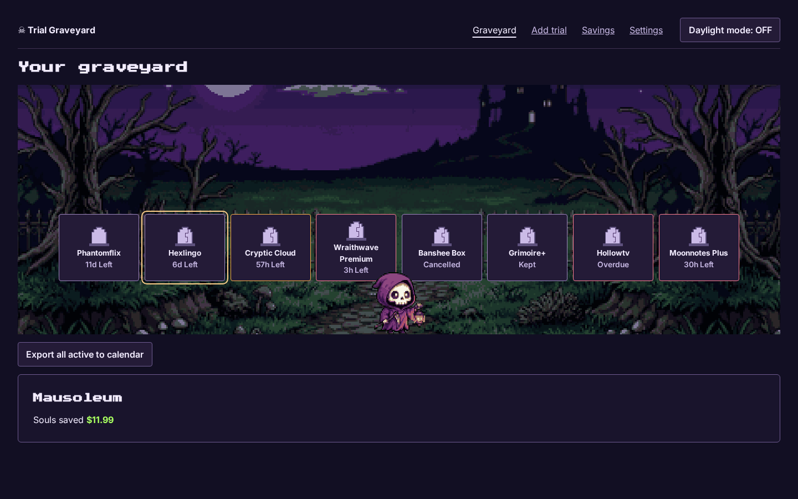

# Trial Graveyard

Catch free trials before the first charge. Trial Graveyard is a private, on-device tracker with a pixel-art graveyard and a high-contrast Daylight list.

[Play Trial Graveyard](https://trial-graveyard-pixel.vercel.app/)

## Run it

Use Node.js 22 and npm.

```sh
npm ci
npm run dev
npm run typecheck
npm test
npm run build
```

The static build is in `dist/`. Set `VITE_BASE=/your-path/` at build time for a subdirectory deployment. The default is `/`. Serve the production build over HTTPS or localhost to enable the offline service worker.

## Screenshots



## Features

Add a trial by hand or paste a receipt to review suggested fields. Grave states show charge urgency, a kept subscription shows its monthly equivalent, and a confirmed cancellation adds one charge to your savings. Export a calendar reminder for one or all trials. Daylight mode keeps the same controls in a calm list, and motion follows your OS setting.

Select **Summon demo graveyard** to explore eight fictional examples. Trial data lives in this browser's IndexedDB.

## Architecture

- Pure trial, clock, currency and calendar logic in `src/domain/`.
- Deterministic receipt parsing in `src/lib/parse/`.
- Zustand with versioned IndexedDB persistence in `src/state/`.
- React views, CSS modules and self-hosted pixel typography in `src/features/` and `src/design/`.

## Built with Kiro

The product rules, spec milestones and hooks are tracked in `.kiro/`. GitHub Actions runs the typecheck, 673 Vitest tests with 100% domain coverage, and the production build.

## License

MIT. See [LICENSE](./LICENSE).
