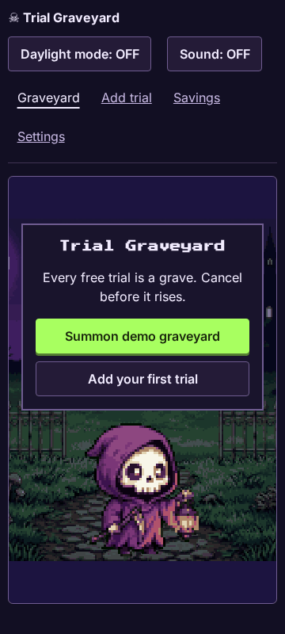

# Trial Graveyard

Catch free trials before the first charge. Trial Graveyard is a private, on-device tracker with a pixel-art graveyard and a high-contrast Daylight list.

[Play Trial Graveyard](https://trial-graveyard-pixel.vercel.app/)

## Run it

Use Node.js 22 and npm.

```sh
npm ci
npm run dev
npm run typecheck
npm test
npm run build
```

The static build is in `dist/`. Set `VITE_BASE=/your-path/` at build time for a subdirectory deployment. The default is `/`. Serve the production build over HTTPS or localhost to enable the offline service worker.

## Screenshots




## Features

Add a trial by hand or paste a receipt to review suggested fields. Grave states show charge urgency, a kept subscription shows its monthly equivalent, and a confirmed cancellation adds one charge to your savings. Export a calendar reminder for one or all trials. Daylight mode keeps the same controls in a calm list, and motion follows your OS setting.

Select **Summon demo graveyard** to explore eight fictional examples. Trial data lives in this browser's IndexedDB. The Mausoleum includes personalized epitaphs and can share an aggregate card with no names or links. Sound effects are synthesized, and start muted.

## Inbox Séance

Open **Inbox Séance** from Add trial to scan 13 fictional messages in the Haunted Demo Inbox. Review and edit the results before burying selected trials. Gmail and Outlook appear as disabled previews. The demo runs in memory and saves only confirmed trial fields.

## Image receipts

Choose a screenshot, use the rear camera, or paste/drop an image in the receipt reader. English OCR runs in a local Tesseract worker. Review the extracted text and date source before saving. Try the included Phantomflix screenshot to see the flow.

The app serves the worker, core and language data from its own origin and caches them on first use for offline reading. Receipt images and OCR text stay in memory.

## Before the Bite

The shared countdown highlights the soonest upcoming active charge. Overdue trials and the next seven days of risk are shown separately. Exorcise opens a local cancellation guide and records a cancellation only when you confirm. The calendar can export reminders 48 hours before and on the morning of the charge.

Settings can export a local JSON backup, validate one for merge or replacement, and clear browser data after typed confirmation.

## Architecture

- Pure trial, clock, currency and calendar logic in `src/domain/`.
- Deterministic receipt parsing in `src/lib/parse/`.
- Zustand with versioned IndexedDB persistence in `src/state/`.
- React views, CSS modules and self-hosted pixel typography in `src/features/` and `src/design/`.

## Built with Kiro

The product rules, spec milestones and hooks are tracked in `.kiro/`. GitHub Actions runs the typecheck, 727 Vitest tests with 100% domain coverage, and the production build.

## Kiro features used

| Feature | Usage |
| --- | --- |
| Steering | Product, stack, structure and MCP conventions |
| Specs | 5 · Trial Graveyard MVP, Haunted Polish, Inbox Séance, Image Receipts, Before the Bite |
| Hooks | 5 · Test on save, spec sync, domain properties, accessibility, copy |
| MCP | GitHub issue context and deployment tools |
| Property-based tests | Boundary, parser, money and archive invariants |
| Agent PRs | The specs and QA notes reference prior agent reviews. This build is committed in six local milestones. |

## License

MIT. See [LICENSE](./LICENSE).
