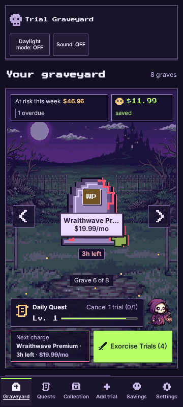
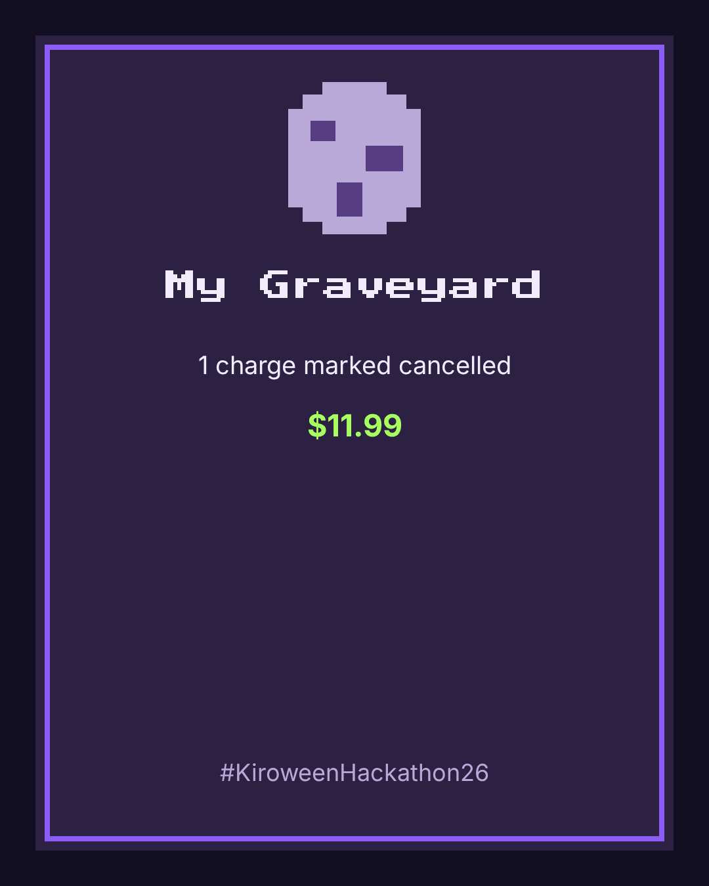

# Trial Graveyard

Catch free trials before the first charge. Trial Graveyard is a private, on-device tracker with a 16-bit pixel cemetery and a high-contrast Daylight list.

[Play Trial Graveyard](https://trial-graveyard-pixel.vercel.app/)

## Run it

Use Node.js 22 and npm.

```sh
npm ci
npm run dev
npm run typecheck
npm test
npm run build
```

The static build is in `dist/`. Set `VITE_BASE=/your-path/` for a subdirectory deployment. The default is `/`. The included Vercel configuration serves app routes through the SPA. Serve the production build over HTTPS or localhost for installability and offline use.

## Screenshots





[Daylight list](docs/screenshots/daylight.png)



## Features

- **Track a trial.** Enter details by hand, paste a receipt, or read a screenshot. Each grave shows its charge and urgency. The default date-only charge time is 09:00 local. Numeric receipt dates use US month/day order.
- **Cancel before the bite.** The HUD and Savings show the same soonest future charge. Overdue trials and upcoming charges at risk this week are separate. Exorcise opens a provider guide and records a cancellation only when you confirm. Cancel, Keep it, and Delete offer ten seconds to undo.
- **Set calendar reminders.** Download a charge-day event with a 24-hour alarm, or add two hauntings at 48 hours before the charge and at 09:00 on the charge date. An earlier charge moves its morning reminder up to the charge time.
- **See savings.** The Mausoleum shows one saved charge per confirmed cancellation, grouped by currency. The stats also show the subset cancelled before its charge this calendar year. The shareable PNG contains only aggregate totals and a count.
- **Explore the cemetery.** Summon eight fictional examples. Add, review, and confirm cancellations to earn cosmetic XP for local quests and gravestone styles. Daylight and Calm modes, OS reduced-motion support, and muted-by-default audio are available.
- **Back up your data.** Export a JSON backup in Settings. Import with schema validation, choose merge or replacement, or clear all saved data with typed confirmation.

## Inbox Séance

Open **Inbox Séance** from Add trial to scan 13 fictional messages in the Haunted Demo Inbox. Review and edit candidates before saving. Gmail and Outlook are disabled. The scanner processes email in memory and saves only fields from trials you select and confirm.

## Image receipts

Choose a screenshot, use the rear camera, or paste or drop an image in the receipt reader. English OCR runs in a local Tesseract worker. Check the exact text used for the charge date before saving, or edit the extracted text and parse it again. **Try a sample screenshot** opens the included Phantomflix receipt.

The worker, core, and language data load from the app's origin on first use. The service worker caches them for later offline reading. Images and extracted text stay in memory.

## Architecture and tests

- Pure trial, clock, urgency, savings, reminder, and XP functions in `src/domain/`.
- Deterministic receipt parsing and an in-memory email provider and scanner in `src/lib/`.
- Zustand with versioned IndexedDB persistence in `src/state/`. A storage notice appears if IndexedDB is unavailable.
- React 18 views and CSS modules in `src/features/`. The palette, SVG pixel sprites, synthesized audio, and self-hosted Press Start 2P and Inter fonts live in `src/design/`.
- Vite and Workbox precache the app shell. A separate runtime cache holds the OCR tools after first use.

GitHub Actions runs strict TypeScript checking, **779 Vitest tests** with **100% domain coverage**, and the production build. The suite includes Testing Library and axe checks plus fast-check properties for dates, money, backups, parsing, and XP isolation. The six checkpoints passed 673, 686, 696, 710, 727, and 779 tests in order.

## Built with Kiro

The product rules, six spec milestones, and hooks are tracked in `.kiro/`. Implementation choices and validation notes are in [docs/DECISIONS.md](docs/DECISIONS.md).

| Feature | Usage |
| --- | --- |
| Steering | Product, stack, structure, and MCP conventions |
| Specs | 6 · Trial Graveyard MVP, Haunted Polish, Inbox Séance, Image Receipts, Before the Bite, Retro Pixel Graveyard |
| Hooks | 5 · Test on save, spec sync, domain properties, accessibility, and copy |
| MCP | GitHub issue context for the milestones |
| Property-based tests | Calendar boundaries, parser behavior, cents arithmetic, backups, and XP independence |
| Agent PRs | The project issues and QA notes incorporate prior agent reviews. This build is recorded in six milestone commits. |

## License

MIT. See [LICENSE](./LICENSE). Self-hosted fonts and the Tesseract runtime retain their respective upstream licenses.
