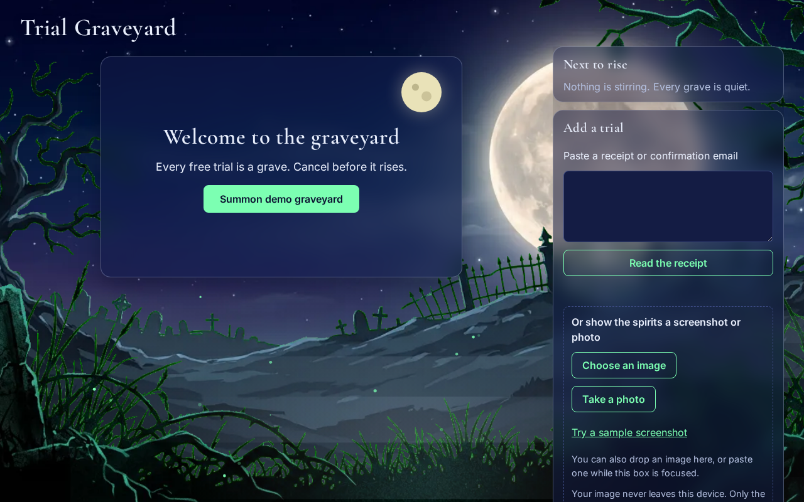
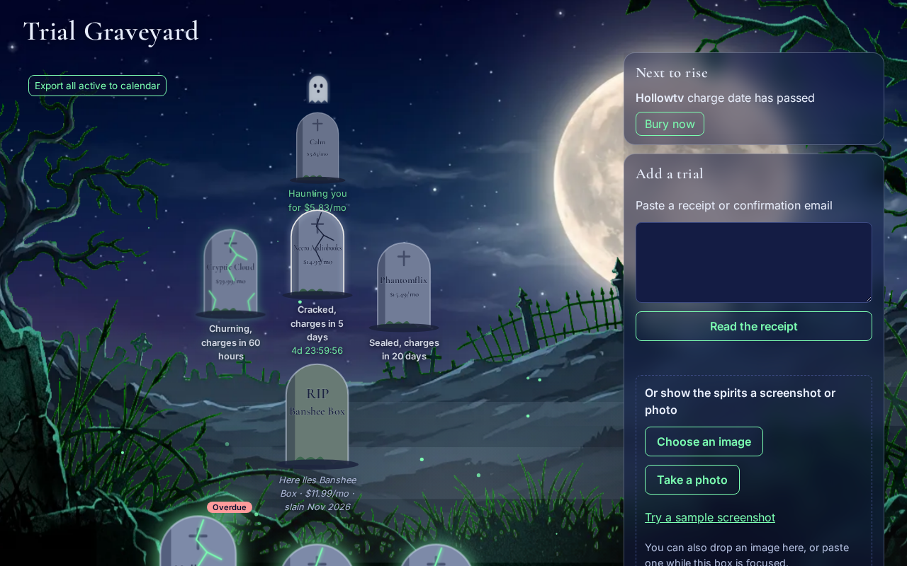
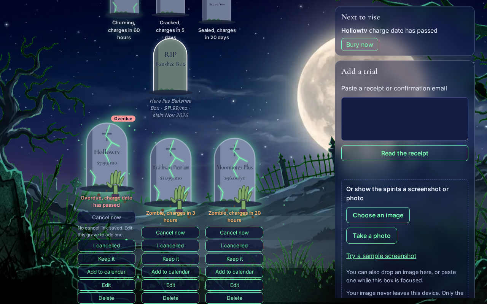
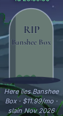
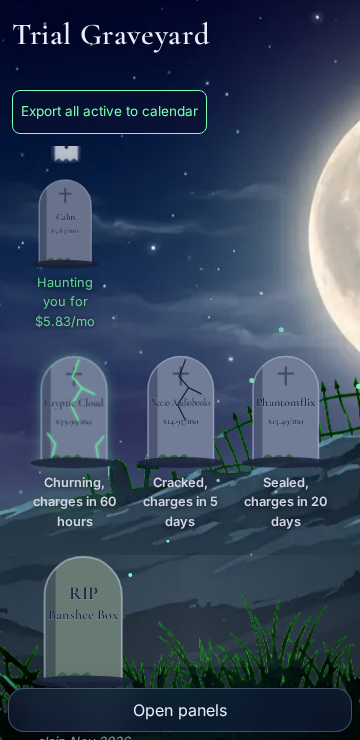
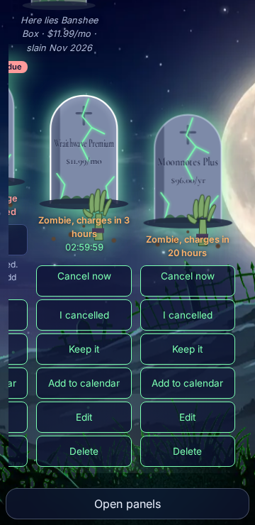

# Trial Graveyard

A haunted tracker for free trials and subscriptions. Every trial is a grave. As the charge date nears, the grave cracks open, and within 48 hours a zombie shambles out to remind you to cancel. Cancelled trials get a tombstone and an epitaph with the money saved.

Built with Kiro for Kiroween 2026 (Costume Contest).

**Live:** https://xuefeng-zhu.github.io/trial-graveyard/ (deployed by GitHub Actions to GitHub Pages on every push to `main`).

The app is local-first and works offline after the first visit (service worker precache).

## Run it

```sh
npm ci          # install
npm run dev     # dev server
npm test        # unit and property tests, with a 100% coverage gate on src/domain/
npm run typecheck
npm run build   # typecheck, then build to dist/ (base path /trial-graveyard/ by default, see Deploy)
npm run preview # serve the production build
```

## Deploy

The public base path is resolved in `vite.base.ts`: `VITE_BASE` if set, else `/` when `VERCEL` is set, else `/trial-graveyard/`. The PWA manifest `scope` and `start_url`, the workbox `navigateFallback` and Vite's `base` all use it, and runtime assets use `import.meta.env.BASE_URL`.

- **GitHub Pages:** no configuration needed. `.github/workflows/deploy.yml` runs typecheck, tests and build on every push to `main` with the default `/trial-graveyard/` base, then publishes `dist/`.
- **Vercel:** import the repo. Vercel sets `VERCEL`, so the base becomes `/`. `vercel.json` sets the build command (`npm run build`), output directory (`dist`), the `vite` framework preset and an SPA rewrite of non-file routes to `/index.html`.
- **Anywhere else:** set `VITE_BASE` at build time, for example `VITE_BASE=/ npm run build` for a root domain or `VITE_BASE=/apps/graveyard/ npm run build` for a sub-path.

## Screenshots

The Moonlit Cemetery pass (see `.kiro/specs/moonlit-cemetery/`) was captured in headless Chromium with the demo graveyard loaded. The visual target is `docs/design/concept-moonlit.jpg`.








The share card image is still a placeholder (`placeholder-share-card.png`).


### Moonlit Cemetery

- **Scene:** a layered parallax backdrop (sky, hills, graves, fog, foreground) that reacts to pointer, scroll and device tilt, with a lazily loaded canvas atmosphere (fog, fireflies, wisps, shooting star) in its own chunk.
- **Interactions:** a once-per-session intro (press Escape or skip to dismiss it), stones that tremble and glow as a charge date nears, a zombie hand and soil burst, a bury animation with a "saved" pop, and sound cues that follow the sound toggle.
- **HUD:** glass panels on the right (a bottom sheet below 900px) hold "Next to rise", the editor and settings.
- **Calm mode:** a persisted HUD setting that turns off decorative motion, in addition to honouring the OS reduced motion preference. The Daylight list stays available as the accessible view.

## Inbox Séance

The crystal-ball button next to "Paste a receipt" opens the Inbox Séance. It connects to an inbox, scans receipt emails for trials, and lists what it found so you can review them and bury the ones you want.

- **How it works:** connect a provider, allow access in a consent step, watch the spirits count up as emails are read, then review each detected trial. Every row has a checkbox, a confidence label, a short source snippet and editable name, date, price and cadence. "Bury selected" adds the checked trials to the graveyard. Trials you already buried do not come back.
- **Mock provider:** for now the only provider is the "Haunted Demo Inbox", an in-memory inbox of fake receipts with relative dates. There are no network calls. Gmail and Outlook show as "coming soon" (see `src/lib/email/providers/README.md`).
- **Privacy:** everything stays on the device. Only the trials you confirm are stored, email bodies are never stored, and Disconnect (or closing the panel) clears everything the spirits saw. The panel explains this under "What the spirits can see".
- **Motion:** the scanning orb stays still when you prefer reduced motion.

## Image receipts

Under "Paste a receipt" you can also show the spirits a screenshot or photo of a confirmation. The text is read on your device and fills the same form as a pasted receipt.

- **How it works:** choose an image, take a photo (on mobile), drop one on the box, or paste one from the clipboard. The image is shrunk to about 1600 px on the long edge and turned gray, then read with [tesseract.js](https://github.com/naptha/tesseract.js) (English). A progress bar with a Cancel button shows while the spirits are deciphering. The fields are prefilled for you to check. A confidence hint and a collapsible "What the spirits read" section show the raw text, which you can fix and read again.
- **Try it:** "Try a sample screenshot" loads a generated Phantomflix receipt from `public/samples/` (made by `scripts/make-samples.py`, all data invented).
- **Lazy loading:** `tesseract.js` is loaded with a dynamic `import()` only after you pick an image, so it is a separate chunk and the main bundle does not grow. The worker, core and English data are fetched on first use and cached by the service worker (`tesseract-assets`), so image receipts work offline afterwards. These assets are not self-hosted: the first read contacts `cdn.jsdelivr.net` and `tessdata.projectnaptha.com`, which can see that the feature was used. The image itself is never sent, and the UI says so.
- **Privacy:** the image never leaves the device. Only the trial you confirm is saved, never the image or the OCR text. The UI says so, and also mentions the CDN download.
- **When it cannot read:** no text gives a friendly message and an "Enter it by hand" button that jumps to the form. A low-confidence read (under 40%) does not prefill the form, but keeps the raw text for you to fix and read again. A picture the browser cannot decode (HEIC, for example) gets its own message.
- **Testing:** OCR sits behind an `OcrEngine` interface (`src/lib/ocr/types.ts`). Tests use a fake engine and never download models.
- **Motion:** the progress shimmer stops when you prefer reduced motion.

## Built with Kiro

- **Steering:** `.kiro/steering/` holds the product metaphor, tech stack and project structure, always included in the agent's context so the costume stays consistent.
- **Spec-driven development:** `.kiro/specs/trial-graveyard-mvp/` has requirements, design and a phased task list. Each phase was implemented against the spec and ticked off in `tasks.md`. A second spec, `.kiro/specs/haunted-polish/`, covers the landing screen, epitaphs, sound, share card and mobile pass. A third spec, `.kiro/specs/inbox-seance/`, covers the Inbox Séance. A fourth, `.kiro/specs/image-receipts/`, covers image receipts. A fifth, `.kiro/specs/moonlit-cemetery/`, covers the cinematic parallax scene, motion mapping, Calm mode and the glass HUD.
- **Agent hooks:** `.kiro/hooks/` has five hooks: test-on-save, domain-property-guard, spec-sync, a11y-check and spooky-copy.
- **MCP:** `.kiro/settings/mcp.json` configures a `fetch` server and a GitHub server, explained in `.kiro/steering/mcp.md`. The token comes from `GITHUB_TOKEN`.
- **Property-based tests:** fast-check covers stage boundaries, savings math, ICS export and the receipt parser, alongside example tests.
- **GitHub-issue driven agent PRs:** each phase was a GitHub issue, and an agent opened a pull request that closed it.

### Kiro features used

| Feature | Where | What it does here |
|---|---|---|
| Steering | `.kiro/steering/` (product, structure, tech, mcp) | Keeps the haunted metaphor, stack and MCP usage consistent. |
| Specs (5) | `.kiro/specs/trial-graveyard-mvp/`, `.kiro/specs/haunted-polish/`, `.kiro/specs/inbox-seance/`, `.kiro/specs/image-receipts/`, `.kiro/specs/moonlit-cemetery/` | Requirements, design and tasks for the MVP, the polish pass, the Inbox Séance, image receipts and the Moonlit Cemetery redesign. |
| Hooks (5) | `.kiro/hooks/` | Test on save, domain property guard, spec sync, a11y check, spooky copy. |
| MCP | `.kiro/settings/mcp.json` | `fetch` for real cancellation and pricing pages, GitHub for follow-up issues. |
| Property-based tests | `src/domain/`, `src/lib/parse/` | fast-check for stages, savings, ICS and the receipt parser. |
| Agent PRs from issues | GitHub issues | Each phase is an issue that an agent closes with a pull request. |

## License

MIT
